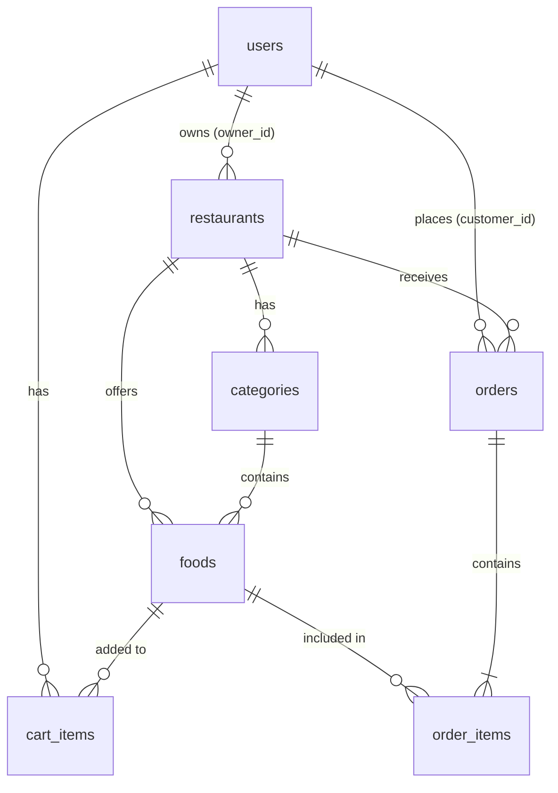

# Database Documentation

## Entity-Relationship Diagram

## Tables Description

### users
Stores all system users including customers, restaurant owners, and administrators.
- `id`: INT, Primary Key, Auto Increment
- `name`: VARCHAR(100), Not Null
- `email`: VARCHAR(120), Unique, Not Null
- `password_hash`: VARCHAR(256), Not Null (Stored securely)
- `phone`: VARCHAR(20)
- `role`: ENUM('customer', 'restaurant', 'admin'), Default 'customer'
- `is_active`: BOOLEAN, Default True
- `created_at`: DATETIME, Default Current Timestamp
- `updated_at`: DATETIME, Auto updates on modification

### restaurants
Stores information about the restaurants registered in the system.
- `id`: INT, Primary Key, Auto Increment
- `owner_id`: INT, Foreign Key -> `users(id)`, Nullable (SET NULL on delete)
- `name`: VARCHAR(150), Not Null
- `description`: TEXT
- `address`: VARCHAR(255)
- `phone`: VARCHAR(20)
- `email`: VARCHAR(120)
- `image_url`: VARCHAR(500)
- `is_active`: BOOLEAN, Default True
- `created_at`: DATETIME, Default Current Timestamp

### categories
Menu categories specific to a restaurant (e.g., Starters, Main Course).
- `id`: INT, Primary Key, Auto Increment
- `restaurant_id`: INT, Foreign Key -> `restaurants(id)`, Not Null (CASCADE on delete)
- `name`: VARCHAR(100), Not Null
- `description`: TEXT
- `image_url`: VARCHAR(500)
- `is_active`: BOOLEAN, Default True
- `display_order`: INT, Default 0
- `created_at`: DATETIME, Default Current Timestamp

### foods
Individual food items offered by restaurants under specific categories.
- `id`: INT, Primary Key, Auto Increment
- `restaurant_id`: INT, Foreign Key -> `restaurants(id)`, Not Null (CASCADE on delete)
- `category_id`: INT, Foreign Key -> `categories(id)`, Not Null (CASCADE on delete)
- `name`: VARCHAR(150), Not Null
- `description`: TEXT
- `price`: DECIMAL(10,2), Not Null
- `image_url`: VARCHAR(500)
- `is_available`: BOOLEAN, Default True
- `is_veg`: BOOLEAN, Default False
- `created_at`: DATETIME, Default Current Timestamp
- `updated_at`: DATETIME, Auto updates on modification

### cart_items
Stores items currently added to a user's shopping cart.
- `id`: INT, Primary Key, Auto Increment
- `user_id`: INT, Foreign Key -> `users(id)`, Not Null (CASCADE on delete)
- `food_id`: INT, Foreign Key -> `foods(id)`, Not Null (CASCADE on delete)
- `quantity`: INT, Not Null, Default 1 (CHECK quantity > 0)
- `created_at`: DATETIME, Default Current Timestamp
- *Unique Constraint*: `uq_user_food` on (user_id, food_id)

### orders
Details of customer orders placed at a restaurant.
- `id`: INT, Primary Key, Auto Increment
- `order_number`: VARCHAR(20), Unique, Not Null
- `customer_id`: INT, Foreign Key -> `users(id)`, Not Null
- `restaurant_id`: INT, Foreign Key -> `restaurants(id)`, Not Null
- `subtotal`: DECIMAL(10,2), Not Null
- `tax`: DECIMAL(10,2), Default 0.00
- `delivery_fee`: DECIMAL(10,2), Default 0.00
- `discount`: DECIMAL(10,2), Default 0.00
- `total_amount`: DECIMAL(10,2), Not Null
- `delivery_address`: VARCHAR(500), Not Null
- `phone`: VARCHAR(20), Not Null
- `payment_method`: VARCHAR(50), Default 'cash_on_delivery'
- `payment_status`: ENUM('pending', 'paid', 'refunded'), Default 'pending'
- `order_status`: ENUM('placed', 'confirmed', 'preparing', 'ready', 'out_for_delivery', 'delivered', 'cancelled'), Default 'placed'
- `notes`: TEXT
- `created_at`: DATETIME, Default Current Timestamp
- `updated_at`: DATETIME, Auto updates on modification

### order_items
Line items corresponding to a specific order. Food names and prices are snapshotted so historical orders are not affected by menu changes.
- `id`: INT, Primary Key, Auto Increment
- `order_id`: INT, Foreign Key -> `orders(id)`, Not Null (CASCADE on delete)
- `food_id`: INT, Foreign Key -> `foods(id)`, Nullable (SET NULL on delete)
- `food_name_snapshot`: VARCHAR(150), Not Null
- `price_snapshot`: DECIMAL(10,2), Not Null
- `quantity`: INT, Not Null
- `subtotal`: DECIMAL(10,2), Not Null

## Indexes
- `cart_items.uq_user_food` (UNIQUE): Ensures a user can only have one cart item entry per food item.
- `orders.idx_customer` (BTREE): Optimizes fetching orders for a specific customer.
- `orders.idx_restaurant` (BTREE): Optimizes fetching orders for a specific restaurant.
- `orders.idx_status` (BTREE): Optimizes filtering orders by their current status.
