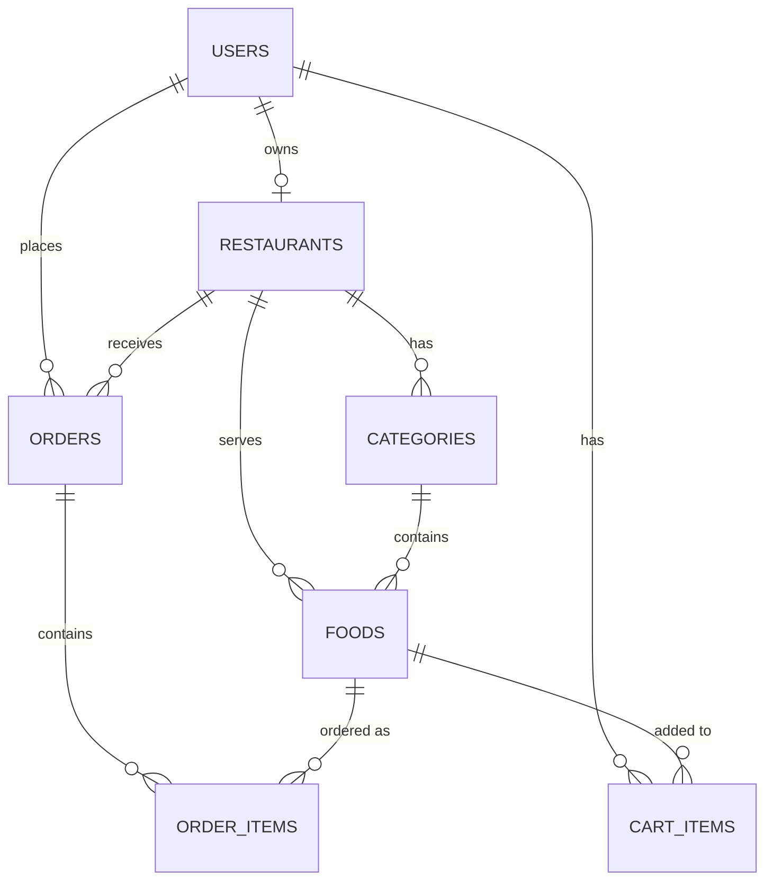

# Phase 1 — Existing Project Inspection Report

> **Status**: Inspection complete. Awaiting user approval before any modifications.

---

## A. Existing Frontend Architecture

### File Inventory

| File | Path | Size | Lines |
|------|------|------|-------|
| HTML | [foodmunchvs.html](file:///e:/Foodbooking/foodmunch/foodmunchvs.html) | 20 KB | 330 |
| CSS | [foodmunchvs.css](file:///e:/Foodbooking/foodmunch/foodmunchvs.css) | 5 KB | 273 |

### External Dependencies (loaded via CDN)

| Library | Version | Purpose |
|---------|---------|---------|
| Bootstrap CSS | 4.5.2 | Grid, navbar, modal, utilities |
| jQuery Slim | 3.5.1 | Bootstrap JS dependency |
| Popper.js | 1.16.1 | Dropdown/tooltip positioning |
| Bootstrap JS | 4.5.2 | Modal, collapse, toggler |
| Font Awesome | 5.x (Kit) | Social icons (Twitter, Instagram, Facebook) |
| Google Fonts | — | Roboto + 9 other families (only Roboto used) |

### What Does NOT Exist

| Asset Type | Present? |
|------------|----------|
| JavaScript files (`.js`) | ❌ None |
| Image assets (local) | ❌ None — all from CDN |
| Login / Register page | ❌ None |
| Cart page | ❌ None |
| Checkout page | ❌ None |
| Order history page | ❌ None |
| Restaurant dashboard | ❌ None |
| Admin dashboard | ❌ None |
| Any forms | ❌ None (the modal is display-only) |
| API calls (`fetch` / `XMLHttpRequest`) | ❌ None |
| localStorage / sessionStorage usage | ❌ None |
| Any JavaScript logic | ❌ None |

> [!IMPORTANT]
> The existing frontend is a **static landing page** only. It has no interactive functionality — no login, no cart, no ordering, no forms, no JavaScript logic. Every page required for the food ordering system (login, register, menu browsing, cart, checkout, order tracking, restaurant dashboard, admin panel) must be **created from scratch** while preserving the existing design language.

---

## B. Existing Features (What the Landing Page Provides)

### Page Sections (mapped from HTML)

| # | Section | HTML Lines | What It Contains |
|---|---------|-----------|------------------|
| 1 | **Navbar** | 13–33 | Fixed-top nav with logo + 4 anchor links |
| 2 | **Hero Banner** | 34–41 | Full-viewport background image, heading "Get Delicious Food Anytime", two CTA buttons |
| 3 | **Why Choose Us** | 42–87 | 3 cards: Food Service, Fresh Food, Best Offers (50% OFF) |
| 4 | **Explore Menu** | 88–192 | 8 food category cards with images and "View All" links |
| 5 | **Healthy Food** | 193–215 | Image + text promoting organic food, "Watch Video" button |
| 6 | **Delivery & Payment** | 216–245 | Info text + payment icons (Visa, MC, PayPal, Amex), "Order Now" button |
| 7 | **Thank You / Gift** | 246–292 | Gradient section with Bootstrap modal for "Redeem Gift" voucher |
| 8 | **Follow Us** | 293–314 | Social icons (Twitter, Instagram, Facebook) in circles |
| 9 | **Footer** | 315–327 | Dark footer with logo, email, address |

### Design System Extracted from CSS

| Token | Value | Usage |
|-------|-------|-------|
| Primary accent | `#d0b200` (gold/amber) | Buttons, links, icons, modal title |
| Button gradient | `linear-gradient(#d0b200, #a58d00)` | `.custom-button` |
| Heading color | `#183b56` (dark navy) | All section headings |
| Body text | `#5a7184` | Descriptions |
| Muted text | `#7b8794` | Card descriptions |
| Dark footer bg | `#0d2436` | Footer |
| Light section bg | `#f9fbfe` | WCU + Healthy food sections |
| Thank-you gradient | `radial-gradient(#fff8db, #fae38c)` | Thank-you section |
| Primary font | Roboto (300, 400, 500, 700) | Everything |
| Border radius | `16px` | Cards |
| Button size | `130px × 45px`, `border-radius: 8px` | CTA buttons |

### What Can Be Reused

1. **Color palette & design tokens** — apply to all new pages for consistency
2. **Navbar structure** — extend with login/cart icons and role-based navigation
3. **Card component pattern** — reuse for food item cards across menu pages
4. **Button styles** — `.custom-button` and `.custom-outline-button` for all CTAs
5. **Section layout pattern** — alternating white/light-gray backgrounds
6. **Footer** — reuse across all pages
7. **Bootstrap 4.5 grid** — continue using for all new layouts
8. **8 menu category images** — map to actual database categories

### Menu Categories Found (Hardcoded)

| Category | Image URL |
|----------|-----------|
| Non-Veg Starters | `em-ginger-fried-img.png` |
| Veg Starters | `em-veg-starters-img.png` |
| Soups | `em-soup-img.png` |
| Fish & Sea food | `em-grilled-seafood-img.png` |
| Main Course | `em-hyderabadi-biryani-img.png` |
| Noodles | `em-mushroom-noodles-img.png` |
| Salads | `em-gluten-img.png` |
| Desserts | `em-coffee-bourbon-img.png` |

---

## C. Missing Backend Functionality

Everything below is **completely missing** and must be built:

### Authentication System
- [ ] User registration (customer, restaurant, admin roles)
- [ ] Login with email/password
- [ ] Session/token management
- [ ] Logout
- [ ] Password hashing (bcrypt/werkzeug)
- [ ] Role-based access control middleware

### User Management
- [ ] Profile view/edit
- [ ] Password change
- [ ] Admin user listing

### Restaurant Management
- [ ] Restaurant profile CRUD
- [ ] Restaurant dashboard with order stats
- [ ] Order management (view, update status)

### Food & Category Management
- [ ] Category CRUD (restaurant/admin)
- [ ] Food item CRUD (restaurant/admin)
- [ ] Food search and filtering
- [ ] Food availability toggling
- [ ] Image management

### Cart System
- [ ] Server-side cart (add, remove, update quantity)
- [ ] Cart total calculation
- [ ] Cart clearing

### Order System
- [ ] Order placement from cart
- [ ] Order number generation
- [ ] Order status workflow (Placed → Confirmed → Preparing → Ready → Out for Delivery → Delivered)
- [ ] Order cancellation
- [ ] Order history per customer
- [ ] Order listing for restaurant

### Admin Panel
- [ ] Dashboard with stats (total orders, revenue, users)
- [ ] User management
- [ ] Order oversight
- [ ] System data management

### Frontend Pages (Must Be Created)
- [ ] Login page
- [ ] Registration page
- [ ] Customer: Menu browsing page (dynamic)
- [ ] Customer: Food detail view
- [ ] Customer: Cart page
- [ ] Customer: Checkout page
- [ ] Customer: Order confirmation page
- [ ] Customer: Order history page
- [ ] Customer: Order tracking page
- [ ] Customer: Profile page
- [ ] Restaurant: Dashboard
- [ ] Restaurant: Menu management (CRUD)
- [ ] Restaurant: Order management
- [ ] Admin: Dashboard
- [ ] Admin: User management
- [ ] Admin: Order overview

---

## D. Required Database Tables

### Entity-Relationship Overview



### Table Specifications

#### 1. `users`
| Column | Type | Constraints |
|--------|------|-------------|
| id | INT | PK, AUTO_INCREMENT |
| name | VARCHAR(100) | NOT NULL |
| email | VARCHAR(120) | UNIQUE, NOT NULL |
| password_hash | VARCHAR(256) | NOT NULL |
| phone | VARCHAR(20) | NULLABLE |
| role | ENUM('customer','restaurant','admin') | NOT NULL, DEFAULT 'customer' |
| is_active | BOOLEAN | DEFAULT TRUE |
| created_at | DATETIME | DEFAULT NOW |
| updated_at | DATETIME | ON UPDATE NOW |

#### 2. `restaurants`
| Column | Type | Constraints |
|--------|------|-------------|
| id | INT | PK, AUTO_INCREMENT |
| owner_id | INT | FK → users.id |
| name | VARCHAR(150) | NOT NULL |
| description | TEXT | NULLABLE |
| address | VARCHAR(255) | NULLABLE |
| phone | VARCHAR(20) | NULLABLE |
| email | VARCHAR(120) | NULLABLE |
| image_url | VARCHAR(500) | NULLABLE |
| is_active | BOOLEAN | DEFAULT TRUE |
| created_at | DATETIME | DEFAULT NOW |

#### 3. `categories`
| Column | Type | Constraints |
|--------|------|-------------|
| id | INT | PK, AUTO_INCREMENT |
| restaurant_id | INT | FK → restaurants.id |
| name | VARCHAR(100) | NOT NULL |
| description | TEXT | NULLABLE |
| image_url | VARCHAR(500) | NULLABLE |
| is_active | BOOLEAN | DEFAULT TRUE |
| display_order | INT | DEFAULT 0 |
| created_at | DATETIME | DEFAULT NOW |

#### 4. `foods`
| Column | Type | Constraints |
|--------|------|-------------|
| id | INT | PK, AUTO_INCREMENT |
| restaurant_id | INT | FK → restaurants.id |
| category_id | INT | FK → categories.id |
| name | VARCHAR(150) | NOT NULL |
| description | TEXT | NULLABLE |
| price | DECIMAL(10,2) | NOT NULL |
| image_url | VARCHAR(500) | NULLABLE |
| is_available | BOOLEAN | DEFAULT TRUE |
| is_veg | BOOLEAN | DEFAULT FALSE |
| created_at | DATETIME | DEFAULT NOW |
| updated_at | DATETIME | ON UPDATE NOW |

#### 5. `cart_items`
| Column | Type | Constraints |
|--------|------|-------------|
| id | INT | PK, AUTO_INCREMENT |
| user_id | INT | FK → users.id |
| food_id | INT | FK → foods.id |
| quantity | INT | NOT NULL, DEFAULT 1, CHECK > 0 |
| created_at | DATETIME | DEFAULT NOW |
| | | UNIQUE(user_id, food_id) |

#### 6. `orders`
| Column | Type | Constraints |
|--------|------|-------------|
| id | INT | PK, AUTO_INCREMENT |
| order_number | VARCHAR(20) | UNIQUE, NOT NULL |
| customer_id | INT | FK → users.id |
| restaurant_id | INT | FK → restaurants.id |
| subtotal | DECIMAL(10,2) | NOT NULL |
| tax | DECIMAL(10,2) | DEFAULT 0 |
| delivery_fee | DECIMAL(10,2) | DEFAULT 0 |
| discount | DECIMAL(10,2) | DEFAULT 0 |
| total_amount | DECIMAL(10,2) | NOT NULL |
| delivery_address | VARCHAR(500) | NOT NULL |
| phone | VARCHAR(20) | NOT NULL |
| payment_method | VARCHAR(50) | DEFAULT 'cash_on_delivery' |
| payment_status | ENUM('pending','paid','refunded') | DEFAULT 'pending' |
| order_status | ENUM('placed','confirmed','preparing','ready','out_for_delivery','delivered','cancelled') | DEFAULT 'placed' |
| notes | TEXT | NULLABLE |
| created_at | DATETIME | DEFAULT NOW |
| updated_at | DATETIME | ON UPDATE NOW |

#### 7. `order_items`
| Column | Type | Constraints |
|--------|------|-------------|
| id | INT | PK, AUTO_INCREMENT |
| order_id | INT | FK → orders.id |
| food_id | INT | FK → foods.id |
| food_name_snapshot | VARCHAR(150) | NOT NULL |
| price_snapshot | DECIMAL(10,2) | NOT NULL |
| quantity | INT | NOT NULL |
| subtotal | DECIMAL(10,2) | NOT NULL |

---

## E. Required API Endpoints

### Authentication (Public)
| Method | Endpoint | Purpose |
|--------|----------|---------|
| POST | `/api/auth/register` | Register new customer |
| POST | `/api/auth/login` | Login, returns session/token |
| POST | `/api/auth/logout` | Logout, invalidate session |
| GET | `/api/auth/me` | Get current user profile |
| PUT | `/api/auth/profile` | Update profile |
| PUT | `/api/auth/password` | Change password |

### Foods (Public read, Restaurant/Admin write)
| Method | Endpoint | Purpose | Auth |
|--------|----------|---------|------|
| GET | `/api/foods` | List all available foods (supports `?category_id=`, `?search=`, `?is_veg=`) | Public |
| GET | `/api/foods/<id>` | Get single food detail | Public |
| POST | `/api/foods` | Create food item | Restaurant/Admin |
| PUT | `/api/foods/<id>` | Update food item | Restaurant/Admin |
| DELETE | `/api/foods/<id>` | Delete food item | Restaurant/Admin |

### Categories (Public read, Restaurant/Admin write)
| Method | Endpoint | Purpose | Auth |
|--------|----------|---------|------|
| GET | `/api/categories` | List all categories | Public |
| GET | `/api/categories/<id>` | Get category with foods | Public |
| POST | `/api/categories` | Create category | Restaurant/Admin |
| PUT | `/api/categories/<id>` | Update category | Restaurant/Admin |
| DELETE | `/api/categories/<id>` | Delete category | Restaurant/Admin |

### Cart (Customer only)
| Method | Endpoint | Purpose |
|--------|----------|---------|
| GET | `/api/cart` | Get current user's cart |
| POST | `/api/cart/items` | Add food to cart |
| PUT | `/api/cart/items/<id>` | Update item quantity |
| DELETE | `/api/cart/items/<id>` | Remove item from cart |
| DELETE | `/api/cart` | Clear entire cart |

### Orders (Customer + Restaurant)
| Method | Endpoint | Purpose | Auth |
|--------|----------|---------|------|
| POST | `/api/orders` | Place order from cart | Customer |
| GET | `/api/orders` | List user's orders | Customer |
| GET | `/api/orders/<id>` | Get order detail | Customer (own) |
| PUT | `/api/orders/<id>/cancel` | Cancel order | Customer (own, if status allows) |

### Restaurant Management
| Method | Endpoint | Purpose | Auth |
|--------|----------|---------|------|
| GET | `/api/restaurant` | Get restaurant info | Public |
| PUT | `/api/restaurant` | Update restaurant info | Restaurant/Admin |
| GET | `/api/restaurant/orders` | List restaurant orders | Restaurant |
| PUT | `/api/restaurant/orders/<id>/status` | Update order status | Restaurant |
| GET | `/api/restaurant/dashboard` | Dashboard stats | Restaurant |

### Admin
| Method | Endpoint | Purpose | Auth |
|--------|----------|---------|------|
| GET | `/api/admin/dashboard` | System-wide stats | Admin |
| GET | `/api/admin/users` | List all users | Admin |
| PUT | `/api/admin/users/<id>` | Update user (role, active) | Admin |
| GET | `/api/admin/orders` | List all orders | Admin |

**Total: ~28 endpoints**

---

## F. Recommended Backend Folder Structure

```
e:\Foodbooking\
│
├── foodmunch/                          ← EXISTING (do not modify structure)
│   ├── foodmunchvs.html                ← Existing landing page
│   └── foodmunchvs.css                 ← Existing styles
│
├── frontend/                           ← NEW frontend pages
│   ├── index.html                      ← Landing page (copy/adapt from foodmunch)
│   ├── login.html
│   ├── register.html
│   ├── menu.html                       ← Dynamic food browsing
│   ├── cart.html
│   ├── checkout.html
│   ├── order-confirmation.html
│   ├── orders.html                     ← Order history
│   ├── order-detail.html
│   ├── profile.html
│   ├── restaurant-dashboard.html
│   ├── restaurant-menu-manage.html
│   ├── restaurant-orders.html
│   ├── admin-dashboard.html
│   ├── admin-users.html
│   ├── admin-orders.html
│   ├── css/
│   │   ├── common.css                  ← Shared design system (from foodmunchvs.css)
│   │   ├── auth.css
│   │   ├── menu.css
│   │   ├── cart.css
│   │   ├── orders.css
│   │   ├── dashboard.css
│   │   └── admin.css
│   ├── js/
│   │   ├── api.js                      ← Shared API client (fetch wrapper)
│   │   ├── auth.js                     ← Login/register/logout logic
│   │   ├── menu.js                     ← Food browsing, search, filter
│   │   ├── cart.js                     ← Cart management
│   │   ├── checkout.js                 ← Checkout logic
│   │   ├── orders.js                   ← Order history/tracking
│   │   ├── restaurant.js              ← Restaurant dashboard logic
│   │   └── admin.js                    ← Admin dashboard logic
│   └── images/                         ← Any local image assets
│
├── backend/
│   ├── app/
│   │   ├── __init__.py                 ← Flask app factory
│   │   ├── config.py                   ← Config classes (dev/prod/test)
│   │   ├── extensions.py              ← db, bcrypt, cors init
│   │   │
│   │   ├── models/
│   │   │   ├── __init__.py
│   │   │   ├── user.py
│   │   │   ├── restaurant.py
│   │   │   ├── category.py
│   │   │   ├── food.py
│   │   │   ├── cart.py
│   │   │   ├── order.py
│   │   │   └── order_item.py
│   │   │
│   │   ├── routes/
│   │   │   ├── __init__.py
│   │   │   ├── auth.py
│   │   │   ├── foods.py
│   │   │   ├── categories.py
│   │   │   ├── cart.py
│   │   │   ├── orders.py
│   │   │   ├── restaurant.py
│   │   │   └── admin.py
│   │   │
│   │   ├── services/
│   │   │   ├── __init__.py
│   │   │   ├── auth_service.py
│   │   │   ├── food_service.py
│   │   │   ├── cart_service.py
│   │   │   └── order_service.py
│   │   │
│   │   └── utils/
│   │       ├── __init__.py
│   │       ├── decorators.py           ← @login_required, @role_required
│   │       └── helpers.py              ← Order number gen, etc.
│   │
│   ├── tests/
│   │   ├── __init__.py
│   │   ├── conftest.py
│   │   ├── test_auth.py
│   │   ├── test_foods.py
│   │   ├── test_cart.py
│   │   ├── test_orders.py
│   │   └── test_roles.py
│   │
│   ├── run.py                          ← Entry point
│   ├── seed.py                         ← Database seeder
│   ├── requirements.txt
│   ├── .env.example
│   └── README.md
│
├── database/
│   ├── schema.sql                      ← Raw SQL DDL (reference)
│   └── seed.sql                        ← Raw SQL seed data (reference)
│
├── docs/
│   ├── architecture.md
│   ├── database.md
│   └── api.md
│
└── README.md                           ← Project-level README
```

> [!NOTE]
> The original `foodmunch/` folder is **preserved untouched**. New frontend pages go in `frontend/` and inherit the same design system by extracting `foodmunchvs.css` into a shared `common.css`.

---

## G. Frontend ↔ Backend Integration Plan

### Strategy

```text
                   ┌──────────────────────┐
                   │   frontend/*.html     │
                   │   (Bootstrap 4.5 +    │
                   │    existing design)   │
                   └──────────┬───────────┘
                              │
                   ┌──────────▼───────────┐
                   │   frontend/js/api.js  │
                   │   Shared fetch()      │
                   │   wrapper with auth   │
                   │   token handling      │
                   └──────────┬───────────┘
                              │  HTTP (JSON)
                   ┌──────────▼───────────┐
                   │   Flask Backend       │
                   │   localhost:5000      │
                   │   /api/*             │
                   └──────────┬───────────┘
                              │  SQLAlchemy
                   ┌──────────▼───────────┐
                   │   MySQL Database      │
                   │   food_ordering_db    │
                   └──────────────────────┘
```

### `api.js` — Central API Client

All frontend JS files will use a shared API client that:
1. Wraps `fetch()` with base URL configuration
2. Automatically attaches auth tokens (stored in `localStorage`)
3. Handles 401 responses (redirect to login)
4. Parses JSON responses
5. Provides error handling

### Authentication Flow

```text
Register/Login → API returns JWT token → Store in localStorage
    → api.js attaches token to every request via Authorization header
    → Flask validates token on protected routes
    → Navbar dynamically shows login/logout/cart based on auth state
```

### Page-by-Page Integration

| Page | Data Source | JS File |
|------|-----------|---------|
| Landing (`index.html`) | Menu categories from `/api/categories` | `menu.js` |
| Menu (`menu.html`) | Foods from `/api/foods?category_id=X` | `menu.js` |
| Cart (`cart.html`) | Cart from `/api/cart` | `cart.js` |
| Checkout (`checkout.html`) | Cart summary + form → `POST /api/orders` | `checkout.js` |
| Orders (`orders.html`) | Orders from `/api/orders` | `orders.js` |
| Restaurant Dashboard | Stats from `/api/restaurant/dashboard`, orders from `/api/restaurant/orders` | `restaurant.js` |
| Admin Dashboard | Stats from `/api/admin/dashboard` | `admin.js` |

### Serving Strategy

Flask will serve the frontend as static files **or** the frontend can be opened directly via file system / a simple HTTP server. CORS is configured to allow cross-origin requests during development.

---

## H. Potential Problems Found

### 🔴 Critical Issues

| # | Problem | Impact | Solution |
|---|---------|--------|----------|
| 1 | **CSS not linked** — `foodmunchvs.html` has no `<link>` tag for `foodmunchvs.css` | Custom styles don't apply at all | Add `<link>` tag when creating `index.html` |
| 2 | **No `<meta viewport>`** | Mobile rendering completely broken | Add viewport meta to all pages |
| 3 | **No `<meta charset>`** | Character encoding issues possible | Add `<meta charset="UTF-8">` |
| 4 | **No `<title>` tag** | Bad SEO, generic browser tab | Add title to all pages |

### 🟡 Design Concerns

| # | Problem | Impact | Solution |
|---|---------|--------|----------|
| 5 | **No existing pages** beyond landing | Entire app UI must be built from scratch | Build all pages using the existing design system |
| 6 | **No JavaScript at all** | Every interaction must be coded | Create modular JS files |
| 7 | **15+ `<h1>` tags** on landing page | SEO penalty, semantic issues | Use proper heading hierarchy in new pages |
| 8 | **All images from external CDN** | Single point of failure | Keep CDN for now, document risk |
| 9 | **Empty `href=""` on "View All" links** | Links reload the page | Wire to actual category pages |
| 10 | **No `alt` attributes on images** | Accessibility violation | Add alt text in new pages |

### 🟢 Architecture Notes

| # | Observation | Decision |
|---|-------------|----------|
| 11 | Existing page is a marketing landing page, not a functional app | Landing page becomes the entry point; all functional pages are new |
| 12 | 8 hardcoded menu categories with CDN images | Seed these exact categories into the database with the same images |

---

## I. Step-by-Step Development Plan

### Phase 1 — Inspection ✅ (This Document)

Inspect existing code, produce this report.

---

### Phase 2 — Architecture & Database Design

- Finalize ER diagram
- Create `database/schema.sql`
- Create `database/seed.sql` with the 8 categories + sample foods
- Create `docs/architecture.md` and `docs/database.md`

---

### Phase 3 — Flask Backend Foundation

- Initialize Flask project with app factory pattern
- Create `config.py` with dev/test/prod configs
- Create `extensions.py` (SQLAlchemy, CORS, Bcrypt)
- Create `run.py` entry point
- Create `requirements.txt`
- Create `.env.example`
- Verify Flask starts and returns a health-check JSON

---

### Phase 4 — SQLAlchemy Models + Database Setup

- Create all 7 models (User, Restaurant, Category, Food, CartItem, Order, OrderItem)
- Configure relationships and cascading
- Create `seed.py` to populate demo data
- Verify database creates correctly in MySQL

**Seed data plan:**
- 1 Restaurant: "Food Munch"
- 8 Categories: Non-Veg Starters, Veg Starters, Soups, Fish & Seafood, Main Course, Noodles, Salads, Desserts
- 3–4 food items per category (~28 food items)
- 3 demo users: `customer@demo.com`, `restaurant@demo.com`, `admin@demo.com` (all password: `Demo@123`)

---

### Phase 5 — Authentication & Role Management

- Implement registration, login, logout
- JWT token-based auth (using `flask-jwt-extended` or session-based)
- `@login_required` decorator
- `@role_required('admin')`, `@role_required('restaurant')` decorators
- Test: register → login → access protected route → denied for wrong role

---

### Phase 6 — Food & Category APIs

- CRUD for categories (Restaurant/Admin only for write)
- CRUD for foods (with search, filter by category, filter by veg/non-veg)
- Public read access, authenticated write access
- Test all endpoints

---

### Phase 7 — Cart APIs

- Add to cart, update quantity, remove, clear, view
- Server-side cart tied to authenticated user
- Calculate subtotals
- Test cart operations

---

### Phase 8 — Order System

- Place order (cart → order + order_items, clear cart)
- Generate unique order numbers (`FM-20260905-0001`)
- Order status workflow
- Order history for customers
- Order listing for restaurant
- Status update by restaurant user
- Cancel by customer (only if status = 'placed')
- Test full order lifecycle

---

### Phase 9 — Frontend Pages + Integration

Build new HTML pages preserving the Food Munch design system:

| Priority | Pages |
|----------|-------|
| 1 | Login, Register |
| 2 | Menu browsing (dynamic categories + foods) |
| 3 | Cart page |
| 4 | Checkout + Order confirmation |
| 5 | Order history + Order detail |
| 6 | Profile page |
| 7 | Restaurant dashboard + menu management + order management |
| 8 | Admin dashboard + user management + order overview |

Create `api.js` and per-page JS files. Wire everything to the Flask backend.

---

### Phase 10 — Testing

- Write pytest tests for auth, foods, cart, orders, roles
- Manual end-to-end testing of all user flows
- Cross-role authorization testing

---

### Phase 11 — Payment Architecture

- Ensure `payment_method` and `payment_status` fields work
- Support "Cash on Delivery" as default
- Document where payment gateway integration would plug in
- No real payment processing

---

### Phase 12 — Documentation & Polish

- Complete `docs/api.md` with all endpoints documented
- Complete `docs/architecture.md`
- Complete project `README.md` with full setup instructions
- Final review and cleanup

---

## User Review Required

> [!IMPORTANT]
> **The existing frontend is a static landing page only.** To build the full food ordering system, I need to create ~15 new HTML pages (login, register, menu, cart, checkout, orders, dashboards, admin panel). These pages will use the **same design system** (colors, fonts, Bootstrap 4.5, card patterns) from your existing CSS so the look and feel is consistent. The original `foodmunch/` folder will remain untouched.

> [!IMPORTANT]
> **Authentication approach**: I plan to use **JWT (JSON Web Tokens)** via `flask-jwt-extended`. Tokens are stored in `localStorage` and sent via `Authorization` headers. This is the standard approach for a Flask + static HTML frontend. If you prefer session-based auth instead, let me know.

## Open Questions

1. **MySQL credentials** — Do you already have MySQL installed? What database name, username, and password would you like to use? (I'll put placeholders in `.env.example` either way.)

2. **Frontend serving** — Would you like Flask to serve the frontend HTML files directly (single server), or do you prefer opening the HTML files separately and having Flask be an API-only server with CORS?

3. **New pages location** — I plan to create new frontend pages in a `frontend/` folder at the project root. Is that acceptable, or would you prefer them inside the existing `foodmunch/` folder?

4. **Food images** — Should I use the existing CDN images for seed data, or would you prefer local placeholder images?

5. **Any additional features** — Are there any specific features your college project requires that aren't covered above (e.g., ratings/reviews, delivery tracking map, coupon system)?
